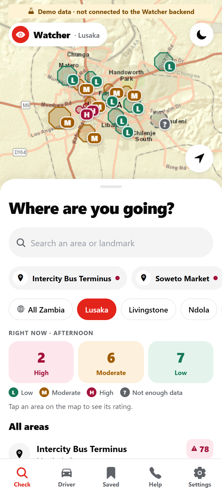
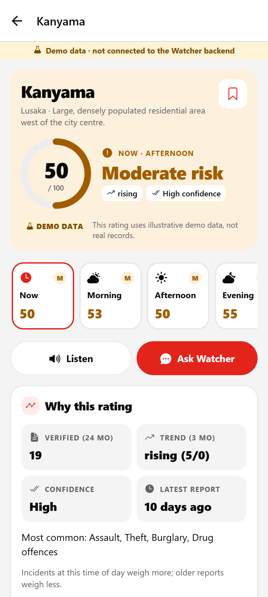
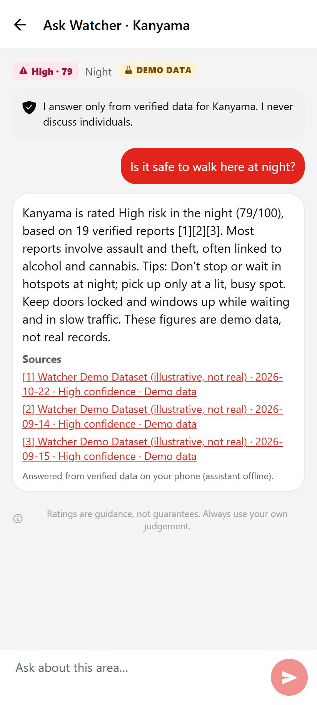
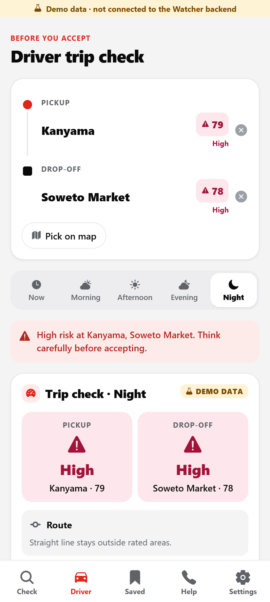
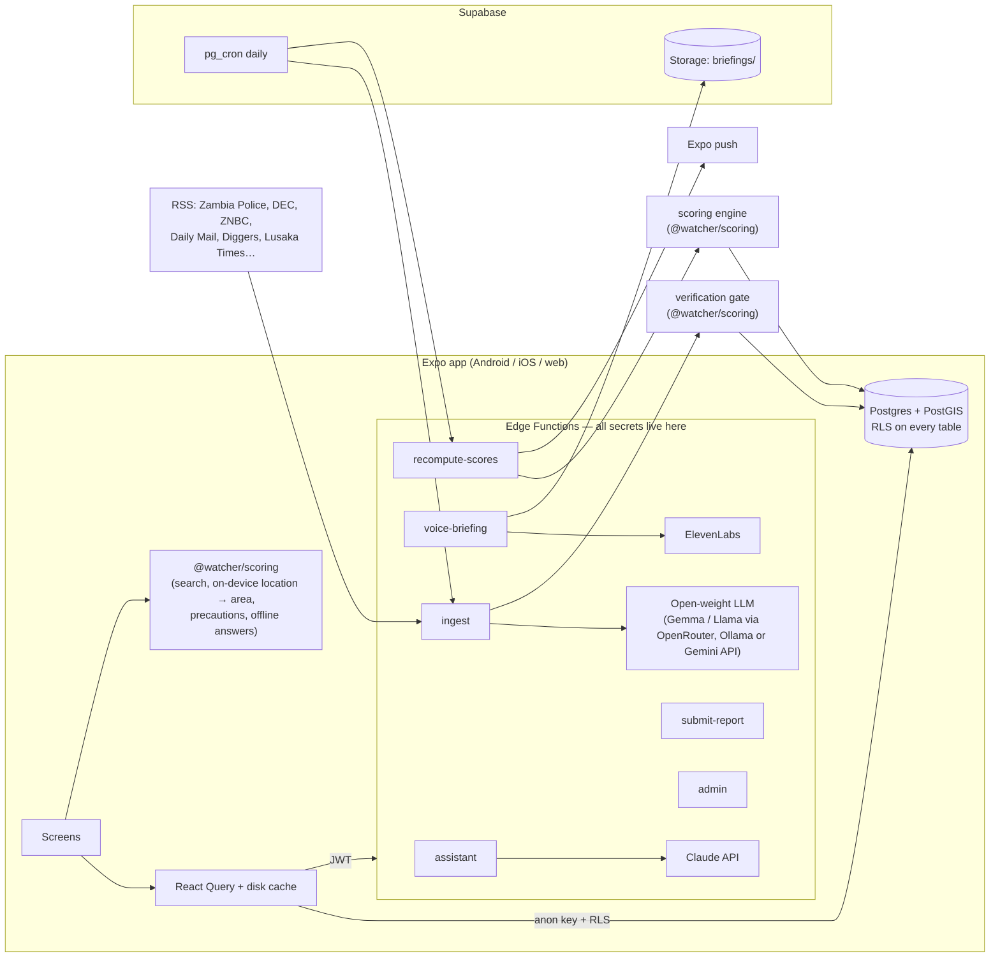

# Watcher

**Know before you go.** Watcher tells visitors, drivers and residents in Zambia how safe an area is before they go there. It gives a **Low / Moderate / High** rating backed only by *verified* records (Zambia Police, Drug Enforcement Commission, ZNBC and established media), shows the substances and crimes most often recorded there, and gives practical precautions.

> Ratings are guidance, not guarantees.

| Check an area | Area detail | Ask Watcher | Driver trip check |
|---|---|---|---|
|  |  |  |  |

The screenshots show **offline demo mode**: every figure in them is labelled demo data, not real records.

---

## The problem

Substance abuse is a growing concern in Zambian towns and is linked to street crime: theft, robbery, assault and burglary. People who don't know an area have nowhere trustworthy to check, including tourists, newcomers and drivers who pick up strangers. Today that information comes from rumour and unverified WhatsApp forwards.

## Who benefits

- **Tourists and visitors:** check a lodge's neighbourhood or a market before going.
- **Drivers** (Yango and other ride-hailing, taxi, bus, minibus, delivery): rate the pickup, the drop-off and the straight-line route before accepting.
- **Newcomers, students and commuters:** learn which times and places need extra care.
- **Parents and guardians:** check where children study, work or travel.
- **Hotels, lodges and tour operators:** brief guests with sourced, current information.
- **Community leaders, authorities and researchers:** see a transparent, source-linked picture of recorded incidents by area and time of day.

## Features

- **Check an area:** debounced search that handles partial names and typos (`kany` finds Kanyama), "Use my location" (resolved on the device), and a map colour-coded by rating (Leaflet with Esri basemaps, no API key). Every area also carries an L/M/H/? letter, so colour is never the only signal.
- **Area detail:** a large rating card with score, trend arrow and confidence. A time-of-day selector (now, morning, afternoon, evening, night) re-scores the area live. Also shown: "Why this rating", top-crimes and top-substances charts, a data-freshness line, and recent verified incidents, each with its source, date, link and confidence badge. A **Demo data** badge appears wherever demo data is used. The screen ends with role- and time-aware precautions, nearby police and clinics (OpenStreetMap Overpass, with a static fallback), and substance-abuse support.
- **Driver mode:** pickup and drop-off by search, current location or tapping the map. The trip card rates both points and every area on the straight-line route between them, and is readable in under 5 seconds. A high-risk banner appears before you accept. It also gives driver-specific advice and steps for declining a trip safely.
- **Voice briefing:** a ~30-second ElevenLabs briefing, cached per area, rating and day in Supabase Storage. It ducks other audio and keeps playing in the background, and falls back to on-device text-to-speech when there is no key or no network.
- **Ask Watcher (Claude):** grounded only on the area's verified data, it cites sources as [n] and says "I don't have verified data for that" when it can't answer. It refuses questions about individuals and can never contradict the engine's rating: a guard replaces any answer that does.
- **Community reports:** report an incident or a safe spot. Reports are shown separately as "Unverified" and never change a rating. They're rate-limited (5 per hour), pass a profanity, stigma and personal-details filter, and carry no photos. Location is attached only if the user opts in.
- **Saved places and history:** push alerts when a saved area's rating changes or a high-confidence incident is verified.
- **Help:** one-tap emergency numbers, substance-abuse support and rehabilitation, and tourism help, all configurable in [`app/src/config/resources.json`](app/src/config/resources.json).
- **Settings:** language (English, Nyanja, Bemba), role, notification toggles, a privacy explanation, delete account and data, the data-source list, and moderator tools for moderators.
- **Offline:** the area list, last-viewed areas, scores and nearby help are persisted to disk, with a "last updated" time on each screen.
- **Admin (moderators):** approve or reject pending incidents (setting an area if the pipeline couldn't map one) and community reports. A CSV/JSON import accepts verified official incidents and statistics.

## Architecture



**One engine everywhere.** `packages/scoring` is pure TypeScript with no I/O. The same code computes scores in the Edge Functions, runs the verification gate on every incoming record, powers search and on-device location in the app, and drives offline demo mode. `npm run sync:scoring` copies it into `supabase/functions/_shared/scoring`, because the Edge Runtime only bundles files under `supabase/functions`. A test fails if the copy is stale.

### Repository layout

```
app/                    Expo SDK 58 app (Expo Router, TypeScript)
  src/app/              screens (tabs: check, driver, saved, help, settings; area/[id], ask/[id], report, admin, onboarding)
  src/components/       UI, rating card, Leaflet map (WebView / iframe), listen button…
  src/data/             live (Supabase) and offline-demo data sources behind one API
  src/i18n/             en (complete), ny (key screens), bem (starter) — non-English needs native review
  src/config/resources.json   emergency numbers, support & rehab, tourism (configurable)
packages/scoring/       shared engine: scoring, verification, geo/search, moderation, precautions, briefing, demo generator + Jest tests
supabase/
  migrations/           schema, RLS, functions (PostGIS)
  seed.sql              GENERATED: sources, 46 areas in all 10 provinces, labelled demo incidents (Lusaka only) + scores
  seed/data/            source of truth: sources.json, areas/<city>.json, demo-profiles.json
  functions/            assistant, voice-briefing, submit-report, admin, ingest, recompute-scores (+ _shared)
  sql/schedule-cron.sql daily ingest/recompute jobs
  tests/                RLS tests (real Postgres+PostGIS via PGlite), Edge Function smoke tests, repo hygiene
scripts/                seed generator, scoring sync, secret scanner, ingestion dry run
docs/                   data sources, scoring, privacy & ethics, Android build, screenshots
```

## Data sources and verification

Full detail is in [docs/data-sources.md](docs/data-sources.md) and [docs/scoring.md](docs/scoring.md).

- **Coverage** is countrywide: every provincial capital, the main Copperbelt, Central and Southern towns, and the Chirundu, Kazungula, Nakonde and Victoria Falls border crossings, 46 areas in all. Centroids outside Lusaka were checked against OpenStreetMap (Nominatim); places with no verifiable point (Kabushi, Nkana East, Kasumbalesa) were left out rather than guessed. Demo incidents exist **only for Lusaka**, so every other town honestly shows "Not enough data" until verified records arrive. A story that names only a town ("in Mongu") is never pinned to a spot in it: it goes to manual review.
- **Allowed sources** are registered in [`supabase/seed/data/sources.json`](supabase/seed/data/sources.json), each with a credibility weight. The official sources are the Zambia Police Service, the DEC and ZamStats. The media sources are ZNBC, the Zambia Daily Mail, the Times of Zambia, News Diggers, Lusaka Times and Mwebantu. Zambian Watchdog is accepted **only as corroboration**.
- **Every record** needs a registered source, a `source_url` on that source's own domain, a `published_date` and an area. Records that can't be traced are **rejected and never scored**. Records whose location can't be mapped go to the moderator queue as `pending`.
- **Confidence:**
  - **High:** an official source, or 2+ independent credible outlets.
  - **Medium:** one credible outlet.
  - **Low:** a single weak source, which goes to the moderator queue.
- **Dedupe and corroboration:** exact duplicates are caught by a hash of the original text. Near-duplicates are matched on area, category, a ±3-day window and summary similarity. A matching story from a *different* outlet is recorded as corroboration and raises the confidence.
- **Copyright:** only a one-sentence summary written by the model, plus the URL, is stored. The full article text is hashed for dedupe and discarded.
- **Scoring:** `score = 100 × (1 − e^(−raw / baseline))`. Here `raw = Σ severity × recency_decay (half-life 6 months) × confidence × source credibility × time-of-day weight`, summed over verified incidents in the last 24 months, and `baseline` depends on the area type (busy hubs need more incidents to score the same). Low is 0–33, Moderate 34–66, High 67–100. Areas with fewer than 4 verified incidents get **"Not enough data"**: Watcher won't guess.

### How the open-weight model is used

Ingestion turns news and press-release text into structured incidents (category, substance, location, date, severity, neutral summary) using an **open-weight model behind one `LLMProvider` interface** ([`supabase/functions/_shared/llm.ts`](supabase/functions/_shared/llm.ts)). You swap the model with an environment variable:

| `LLM_PROVIDER` | Model | Notes |
|---|---|---|
| `openai_compatible` | e.g. `google/gemma-3-27b-it` on OpenRouter, `gemma3:12b` or `llama3.1` on local **Ollama**, vLLM, Groq | Any OpenAI-style `/chat/completions` endpoint |
| `gemini` | `gemma-3-27b-it` via the Gemini API | Key sent in a header, never in the URL |
| `heuristic` | none | Keyword rules; used in tests and when nothing is configured |

Model output is validated with zod. Anything malformed is discarded, and the model never decides what is "verified"; the deterministic verification gate does. Claude is used for something different: explaining the computed rating and answering questions from the verified data.

## Setup in under 10 minutes

**Requirements:** Node 22.18+ (Node 24 recommended) and npm 10+. A Supabase project is optional at first.

### 1. Run the app right away (offline demo mode)

```bash
git clone <this repo> watcher && cd watcher
npm install
npm run web          # opens the app in a browser at http://localhost:8081
# or: npm start      # then scan the QR code with Expo Go on Android
```

With no backend configured, the app runs fully offline on the **labelled demo dataset**, scored on-device by the same engine. A banner says so on every screen.

### 2. Connect a Supabase backend

One script deploys everything to a Supabase project you own, using your own CLI login. It creates nothing until you run it, and it's safe to re-run.

1. Create an empty project at [supabase.com](https://supabase.com) and note its **project ref** (the 20 characters in its URL). In **Authentication → Sign In / Providers**, enable **Allow anonymous sign-ins**.
2. Optional: copy [`.env.example`](.env.example) to `supabase/functions/.env` and fill in the keys you have (Claude, ElevenLabs, ingestion LLM). Every key is optional; each feature degrades gracefully without one. The file is git-ignored.
3. Deploy:
   ```bash
   npx supabase login
   npm run deploy:backend -- --project-ref <project-ref>            # add --dry-run first to see the steps
   ```
   The script links the project, applies the migrations, seeds the real sources and all 46 areas, and sets the function secrets. It then deploys the 6 Edge Functions, stores the project URL and a generated `CRON_SECRET` in Vault, and schedules the daily ingest and recompute with pg_cron. Finally it computes the first scores, writes `app/.env.local` (public URL and publishable key only) and smoke-tests the live API.
   It seeds **no demo incidents** unless you pass `--with-demo`, so a fresh backend shows "Not enough data" everywhere until real verified records are ingested or imported. Have your database password ready: `supabase link` asks for it, or you can set `SUPABASE_DB_PASSWORD`.
4. Run `npm run web` or `npm start` again. The demo banner disappears and the app reads the live backend.
5. **Make yourself a moderator.** Open Settings and copy your Account ID, then run this in the SQL editor:
   `update public.profiles set is_moderator = true where id = '<account id>';`

`ingest` and `recompute-scores` are deployed with `verify_jwt = false` (see `supabase/config.toml`) because pg_cron calls them with the `x-watcher-cron-secret` header rather than a user JWT. Their handlers still reject anything that isn't the cron secret or the service role key.

### Environment variables

| Where | Variable | Purpose |
|---|---|---|
| app (public) | `EXPO_PUBLIC_SUPABASE_URL`, `EXPO_PUBLIC_SUPABASE_ANON_KEY` | Backend; empty means offline demo mode |
| functions | `ANTHROPIC_API_KEY`, `ANTHROPIC_MODEL` | Ask Watcher (default `claude-sonnet-5-5`) |
| functions | `ELEVENLABS_API_KEY`, `ELEVENLABS_VOICE_ID`, `ELEVENLABS_MODEL_ID` | Voice briefing |
| functions | `LLM_PROVIDER`, `LLM_BASE_URL`, `LLM_API_KEY`, `LLM_MODEL`, `GEMINI_API_KEY` | Open-weight extraction model |
| functions | `CRON_SECRET`, `INGEST_MAX_ITEMS`, `INGEST_MAX_AGE_DAYS`, `GEOCODER` | Ingestion |
| functions | `SUPABASE_URL`, `SUPABASE_SERVICE_ROLE_KEY` | Injected automatically by Supabase |

No secret is ever bundled into the app. `npm run check:secrets` (also part of `npm test`) fails if a key-like string is committed, or if app code references a server-only secret name.

## Running the ingestion locally

```bash
# Real feeds → robots.txt check → extraction → verification → area mapping, into an in-memory store (no DB):
npm run ingest:dry
# With a local open-weight model:
LLM_PROVIDER=openai_compatible LLM_BASE_URL=http://localhost:11434/v1 LLM_MODEL=gemma3:12b npm run ingest:dry
# One-off backfill window:
INGEST_MAX_AGE_DAYS=120 INGEST_MAX_ITEMS=60 npm run ingest:dry

# Against a local Supabase stack (needs Docker):
npx supabase start && npx supabase functions serve --env-file supabase/functions/.env
curl -X POST http://127.0.0.1:54321/functions/v1/ingest -H "x-watcher-cron-secret: $CRON_SECRET" -H "Content-Type: application/json" -d '{}'
```

## Tests and checks

```bash
npm run typecheck    # app, scoring engine, Edge Functions (tsc)
npm run lint         # ESLint (expo config for the app, typescript-eslint elsewhere), zero warnings
npm test             # 95 Jest tests: engine, verification, RLS on real Postgres+PostGIS, Edge Function smoke tests, secret scan
npm run verify       # all of the above + scoring-copy sync check
```

- **Scoring and verification** ([`packages/scoring/test`](packages/scoring/test)) cover: decay, time bands, thresholds, "insufficient data", trends, and pending/rejected/unknown-source exclusion. They also cover the rejection of untraceable records (unknown outlet, off-domain URL, missing or future date, uncorroborated Watchdog, demo source), confidence rules, dedupe and corroboration, moderation and rate limits, and the demo dataset labelling.
- **RLS** ([`supabase/tests/rls.test.ts`](supabase/tests/rls.test.ts)) runs the real migrations and seed on Postgres + PostGIS (PGlite) under the `anon` and `authenticated` roles. It checks that clients can only see verified incidents, can't write incidents, scores or sources, can't read other users' saved places, history or reports, can't insert reports directly, and can't make themselves moderators. It also checks that account deletion cascades.
- **Edge Functions** ([`supabase/tests/functions.test.ts`](supabase/tests/functions.test.ts)) smoke-test every handler with mocked network calls. Among other things, they assert that **unverified community reports never change a rating**.

Optional: `npx deno check` on each `supabase/functions/*/index.ts` (with `--config <fn>/deno.json`) type-checks the Deno entry points; all six pass.

## Android APK

See [docs/android-build.md](docs/android-build.md). In short:

```bash
npm i -g eas-cli && eas login
cd app && eas init            # creates the EAS project and writes its projectId (also enables push)
eas build -p android --profile preview    # produces an installable .apk (cloud build, no Android SDK needed)
```

A local build is also possible: `npm run build:apk:local`, which needs the Android SDK and JDK 17.

## Privacy and ethics

Full detail is in [docs/privacy-ethics.md](docs/privacy-ethics.md).

- **Areas, not people.** Watcher never identifies, photographs or profiles individuals, including people struggling with addiction. The extraction prompt strips names. The assistant refuses questions about individuals. Community notes containing phone numbers, emails, links or stigmatising labels are rejected. Every rating comes with support and rehabilitation resources.
- **Non-stigmatising language** throughout ("substance abuse", "people who use drugs").
- **Location stays on the phone.** It is used only to find the area you're in, and is never sent unless you switch on "attach my location" for a report.
- **No accounts to create.** Each install gets an anonymous account, so RLS can keep saved places, history and reports private. "Delete my account and data" removes all of it.
- **No fabrication.** The demo dataset is fictional, attributed to the fictional "Watcher Demo Dataset" source (never to a real outlet), flagged `is_demo`, and labelled in the UI. Demo ratings for real neighbourhoods are arbitrary and say nothing about those places. Replace them with real records before any public use.
- **Ratings are guidance, not guarantees.** That disclaimer appears on every rating screen, in the briefing and in assistant answers.

## Roadmap

- Ingest real verified records: data-sharing agreements with Zambia Police and the DEC, and permission from outlets whose robots.txt blocks crawlers.
- Surveyed area polygons (boundaries are still circles around OpenStreetMap centroids), and more neighbourhoods outside Lusaka. Adding a place is a data change: add a row to `supabase/seed/data/areas/<province>.json` and regenerate the seed (a new file must also be imported in `app/src/data/demoSource.ts`).
- Native-speaker review of the Nyanja and Bemba strings, and full Bemba coverage.
- Route-based (road network) driver corridor instead of a straight line.
- Moderator audit log and two-person review for high-severity records.

## Licence

MIT. See [LICENSE](LICENSE). Basemap tiles © Esri (sources: Esri, HERE, Garmin, © OpenStreetMap contributors).
